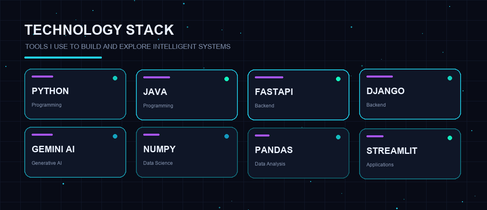
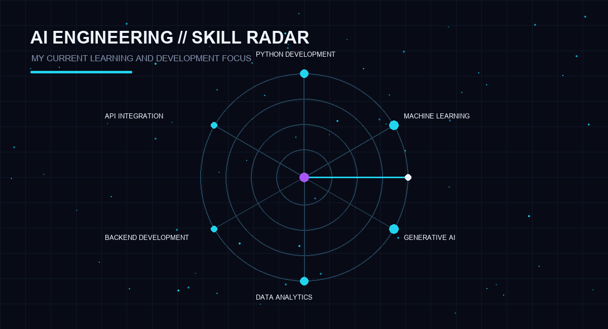

# Hey, I'm Faheem 👋

### Aspiring AI Engineer · Python Developer · Generative AI Learner

I’m a B.Tech Computer Science student interested in building practical applications with Python, machine learning and generative AI. I learn by experimenting, building projects and improving them step by step.

 

---

## About

- 🎓 B.Tech Computer Science & Engineering — Mewar University
- 🤖 Career direction: AI Engineering and Generative AI
- 🐍 Main programming language: Python
- 🧪 Interested in machine learning, data analytics and LLM applications
- 🌹 Building ROSE, a modular personal AI assistant

## Technology Toolkit

  

## Selected Projects

### 🌹 ROSE — Personal AI Assistant
A personal AI assistant project with a modular structure and General Assistant and Coding Assistant modules. Google Gemini API integration is part of the current development direction.

**Status:** Under development.

### 📊 European Banking Churn Analytics
Analysed 10,000 banking customer records, explored segmentation and churn patterns, and created an interactive Streamlit dashboard.

[View repository](https://github.com/faheemashraf753/European-Banking-Churn-Analytics)

### 💳 Credit Risk Prediction
A machine-learning project covering financial data preparation, exploratory analysis and credit-risk prediction.

### ☕ Afficionado Coffee Forecasting
Retail transaction analysis and demand forecasting exploration.

### 🌐 Facebook UI Clone
A Django-based web development training project.

## Contribution Activity

## GitHub Statistics

---

**Keep learning. Keep building. Keep improving.**

