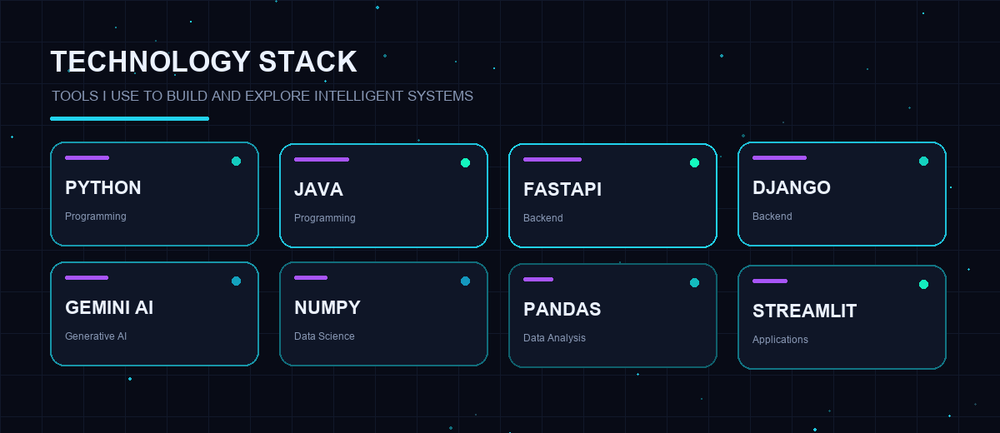

 

<h1>Hey, I'm Faheem 👋</h1>

### Aspiring AI Engineer | Python Developer | Generative AI Enthusiast

  

  
  

---

## `$ whoami`

I'm a Computer Science undergraduate pursuing B.Tech in Computer Science and Engineering at Mewar University.

My current focus is building a strong foundation in **Artificial Intelligence, Machine Learning, and Generative AI**.

I enjoy experimenting with Python, exploring AI tools, building practical applications, and learning how intelligent systems work behind the scenes.

- 🎓 B.Tech CSE — Mewar University
- 🤖 Career focus — AI & Generative AI Engineering
- 🐍 Primary language — Python
- 🧠 Currently exploring — Machine Learning and LLM applications
- 🛠️ Building — ROSE, my personal AI assistant
- 📍 India

---

## `$ tech_stack`

### Programming Languages

  

### AI, Machine Learning & Data

  
  
  
  
  

### Development & Tools

  
  

---

## `$ featured_projects`

### 🤖 ROSE — Personal AI Assistant

A personal AI assistant designed to bring AI-powered assistance into everyday workflows.

- Python-based backend
- Google Gemini API integration
- General Assistant and Coding Assistant
- Modular architecture with a web interface

**Status:** Actively developing.

---

### 📊 European Banking Churn Analytics

An analytics project exploring customer behaviour and churn patterns using banking data.

- Analysed 10,000 customer records.
- Explored customer segmentation and churn patterns.
- Built an interactive Streamlit dashboard.
- Used Python, Pandas, Plotly and data visualisation.

**Repository:** [View Project](https://github.com/faheemashraf753/European-Banking-Churn-Analytics)

---

### 💳 Credit Risk Prediction

A machine learning project focused on analysing financial data and predicting customer credit risk.

- Data preprocessing and exploratory analysis.
- Machine learning model development.
- Prediction interface using Streamlit.

---

### ☕ Afficionado Coffee Forecasting

A data analytics project focused on transaction analysis and demand forecasting using retail transaction data.

---

### 🌐 Facebook Clone

A web development project built using Python and Django as part of my development training.

---

## `$ github_activity`

 

---

## `$ currently_learning`

- Python programming and problem solving
- Machine Learning fundamentals
- Generative AI and LLM applications
- API integration and backend development
- Building practical AI-powered applications

---

### "Build something useful. Understand how it works. Make it better."

  

**Thanks for visiting my digital space!**

