 

# Hey, I'm Faheem! 👋

### Aspiring AI Engineer | Python Developer

I'm a Computer Science student interested in Artificial Intelligence, Machine Learning and Generative AI.

I enjoy learning new technologies and building projects that solve real problems.

 

  

---

## About Me

- 🎓 B.Tech in Computer Science and Engineering
- 🏫 Mewar University
- 📍 India
- 💻 Interested in AI Engineering and Generative AI
- 🐍 Working mainly with Python
- 🚀 Currently building my personal AI assistant, ROSE

---

## Technologies I Use

  

---

## My Current Focus

I'm currently spending time learning and improving in:

- Python programming
- Machine Learning
- Generative AI and LLMs
- Data Analytics
- Backend Development
- API Integration

---

## Featured Projects

### 🤖 ROSE — Personal AI Assistant

My personal AI assistant project, designed to make everyday tasks easier through AI-powered assistance.

- Python backend
- Google Gemini API integration
- General Assistant
- Coding Assistant
- Modular application structure

**Status:** Under development.

### 📊 European Banking Churn Analytics

An interactive data analytics project exploring customer behaviour and banking churn.

- Analysed 10,000 customer records
- Explored customer segmentation
- Studied churn patterns
- Created a Streamlit dashboard

[View Project](https://github.com/faheemashraf753/European-Banking-Churn-Analytics)

### 💳 Credit Risk Prediction

A machine learning project that analyses financial data and predicts customer credit risk.

- Data cleaning and preprocessing
- Exploratory Data Analysis
- Machine Learning
- Streamlit prediction interface

### ☕ Afficionado Coffee Forecasting

A data analytics project focused on understanding retail transactions and forecasting demand.

### 🌐 Facebook Clone

A web development project built with Python and Django.

---

---

## Contribution Activity

---

## GitHub Statistics

 

---

### Thanks for visiting my profile! 👋

**Keep learning. Keep building. Keep improving.**

