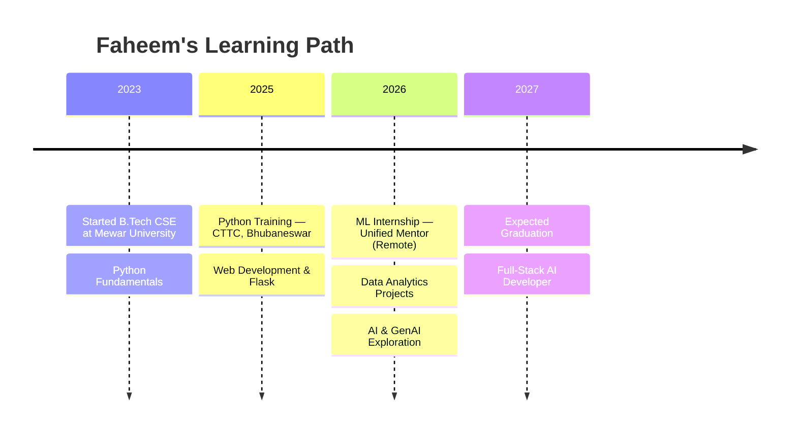

<div align="center">


<br>


&nbsp;


<br><br>

[](https://github.com/faheemashraf753)
[](https://www.linkedin.com/in/faheem-ashraf-rather)
[](mailto:faheemashraf753@gmail.com)

</div>

---


##  &nbsp; `01` — About Me


I'm **Faheem Ul Islam Rather**, a passionate **Computer Science & Engineering** student at the intersection of **Software Development**, **Data Science**, and **Artificial Intelligence**.

My journey is driven by **curiosity**, **experimentation**, and the drive to build technology that pushes beyond theory into real-world impact.

Currently I'm strengthening programming fundamentals, exploring Machine Learning, working with data, and building projects that demonstrate how intelligent systems work in practice.

<br>

```python
class FaheemAshraf:
    def __init__(self):
        self.name        = "Faheem Ul Islam Rather"
        self.role        = "CS Student | AI Enthusiast | ML Explorer"
        self.university  = "Mewar University, Rajasthan"
        self.batch       = "2023 – 2027"
        self.location    = "India 🇮🇳"
        self.interests   = ["AI & GenAI", "Machine Learning", "Data Analytics",
                            "LLMs", "Python Dev", "AI Applications"]
        
    def current_focus(self):
        return {
            "🤖 AI": "Generative AI & Large Language Models",
            "📊 Data": "Machine Learning & Data Analytics",
            "🐍 Code": "Python & Software Development",
            "💡 Build": "AI-Powered Real-World Applications",
        }
        
    def quote(self):
        return "Exploring intelligence. Building ideas. Turning code into possibilities."

me = FaheemAshraf()
print(me.quote())
```

<br>


##  &nbsp; `02` — Tech Stack

<div align="center">

### 🔥 Languages

<p>


</p>

### 🤖 AI / ML / Data Science

<p>


</p>

### 🌐 Web & Frameworks

<p>


</p>

### 🛠️ Tools & Platforms

<p>


</p>

</div>

<br>

<div align="center">

</div>

<br>


##  &nbsp; `03` — Featured Projects

<div align="center">

<a href="https://github.com/faheemashraf753/European-Banking-Churn-Analytics">
  
</a>
&nbsp;
<a href="https://github.com/faheemashraf753/rose-ai-platform">
  
</a>

</div>

<br>

<table>
<tr>
<td width="50%">

### 🏦 European Banking Churn Analytics
> Customer analytics project exploring churn patterns and factors driving customer attrition in the banking domain.

**🔧 Tech:** `Python` · `Pandas` · `Plotly` · `Streamlit`

[](https://github.com/faheemashraf753/European-Banking-Churn-Analytics)

</td>
<td width="50%">

### 💳 Credit Risk Prediction
> ML project focused on credit-risk analysis, data preprocessing, predictive modeling, and data-driven risk assessment.

**🔧 Tech:** `Python` · `Scikit-learn` · `Pandas` · `ML`

[](https://github.com/faheemashraf753)

</td>
</tr>
<tr>
<td width="50%">

### 🌹 ROSE — AI Platform
> Full-stack modular multi-assistant AI platform integrating AI capabilities with backend infrastructure and application development.

**🔧 Tech:** `Python` · `FastAPI` · `MySQL` · `AI Integration`

[](https://github.com/faheemashraf753/rose-ai-platform)

</td>
<td width="50%">

### ☕ Afficionado Coffee Forecasting
> Data analytics project exploring data-driven insights and forecasting through an interactive dashboard approach.

**🔧 Tech:** `Python` · `Data Analytics` · `Visualization`

[](https://github.com/faheemashraf753)

</td>
</tr>
</table>

<br>


##  &nbsp; `04` — GitHub Analytics

<div align="center">


&nbsp;


<br><br>


<br><br>

### 🏆 GitHub Trophies


<br><br>

### 📈 Contribution Activity


<br>

### 🐍 Contribution Snake

<picture>
  <source media="(prefers-color-scheme: dark)" srcset="https://raw.githubusercontent.com/faheemashraf753/faheemashraf753/output/github-snake-dark.svg">
  <source media="(prefers-color-scheme: light)" srcset="https://raw.githubusercontent.com/faheemashraf753/faheemashraf753/output/github-snake.svg">
  
</picture>

</div>

<br>


##  &nbsp; `05` — Journey

<br>

<div align="center">



</div>

<br>

<details>
<summary><b>🎓 &nbsp; Education</b></summary>
<br>


**Mewar University** · Chittorgarh, Rajasthan  
📅 **2023 – 2027**

</details>

<details>
<summary><b>🤖 &nbsp; Machine Learning Internship — Unified Mentor</b></summary>
<br>


**Unified Mentor** · Remote  
📅 **March 2026 – June 2026**

Project-based ML internship with practical exposure to real machine learning pipelines, model building, and data-driven solutions.

</details>

<details>
<summary><b>🐍 &nbsp; Python Development Training — CTTC</b></summary>
<br>


**Central Tool Room & Training Centre (CTTC)** · Bhubaneswar  
📅 **April 2025 – May 2025**

Hands-on Python programming and project-based learning focused on applied development.

</details>

<br>


##  &nbsp; `06` — Beyond the Code

<div align="center">

<table>
<tr>
<td align="center" width="140">

</td>
<td align="center" width="140">

</td>
<td align="center" width="140">

</td>
<td align="center" width="140">

</td>
</tr>
<tr>
<td align="center" width="140">

</td>
<td align="center" width="140">

</td>
<td align="center" width="140">

</td>
<td align="center" width="140">

</td>
</tr>
</table>

<br>

> *"My goal is to continuously evolve from learning technologies to building meaningful applications that make a difference."*

</div>

<br>


##  &nbsp; `07` — Let's Connect

<div align="center">

<br>

[](https://github.com/faheemashraf753)
&nbsp;
[](https://www.linkedin.com/in/faheem-ashraf-rather)
&nbsp;
[](mailto:faheemashraf753@gmail.com)

<br><br>


</div>

---

<div align="center">
<sub>✨ Designed & crafted by <strong>Faheem Ul Islam Rather</strong> · Powered by passion & curiosity ✨</sub>
</div>
