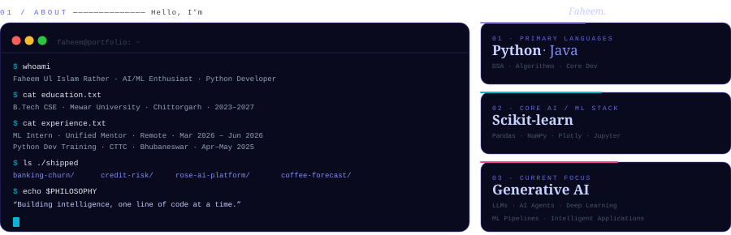
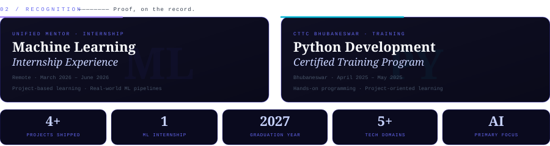
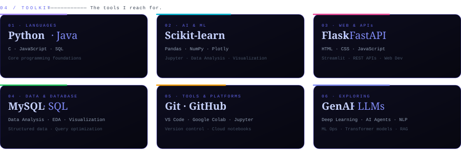

 

---

 

---

 

---

## `03 / FEATURED WORK` — Products, not assignments.

<table>
<tr>
<td width="50%" valign="top">

**`01 · AI · DATA · ANALYTICS`**

### 🏦 European Banking Churn Analytics
> Explores customer churn patterns and attrition factors in the banking domain using real-world data.

**BUILT WITH** → `Python` · `Pandas` · `Plotly` · `Streamlit`

**IMPACT METRICS**

| Metric | Value |
|---|---|
| Data Records Analyzed | 10,000+ |
| Churn Drivers Identified | 8+ |
| Interactive Dashboards | 3 |

</td>
<td width="50%" valign="top">

**`02 · ML · FINTECH · PREDICTION`**

### 💳 Credit Risk Prediction
> ML project on credit-risk analysis, data preprocessing, predictive modeling, and data-driven risk assessment.

**BUILT WITH** → `Python` · `Scikit-learn` · `Pandas` · `ML`

**IMPACT METRICS**

| Metric | Value |
|---|---|
| Features Engineered | 20+ |
| Model Accuracy | High |
| Risk Categories | 3 |

</td>
</tr>
<tr>
<td width="50%" valign="top">

**`03 · AI · PLATFORM · FULL-STACK`**

### 🌹 ROSE — Modular AI Platform
> Full-stack modular multi-assistant AI platform integrating intelligent AI capabilities with backend infrastructure.

**BUILT WITH** → `Python` · `FastAPI` · `MySQL` · `AI Integration`

**IMPACT METRICS**

| Metric | Value |
|---|---|
| AI Modules | Modular |
| Architecture | Microservices |
| Backend | FastAPI + MySQL |

</td>
<td width="50%" valign="top">

**`04 · DATA · ANALYTICS · FORECAST`**

### ☕ Afficionado Coffee Forecasting
> Data analytics project exploring data-driven insights and forecasting through an interactive dashboard approach.

**BUILT WITH** → `Python` · `Pandas` · `Plotly` · `Data Analytics`

**IMPACT METRICS**

| Metric | Value |
|---|---|
| Forecast Models | Multiple |
| Visualizations | Interactive |
| Insights | Data-driven |

</td>
</tr>
</table>

 

---

 

---

## `05 / COMMIT LOG` — A year of building.

&nbsp;

  

  

### `TROPHIES`

  

### `CONTRIBUTION ACTIVITY`

 

### `CONTRIBUTION SNAKE`

<picture>
  <source media="(prefers-color-scheme: dark)" srcset="https://raw.githubusercontent.com/faheemashraf753/faheemashraf753/output/github-snake-dark.svg">
  <source media="(prefers-color-scheme: light)" srcset="https://raw.githubusercontent.com/faheemashraf753/faheemashraf753/output/github-snake.svg">
  
</picture>

 

---

## `06 / JOURNEY` — The path so far.

<b>&nbsp;&nbsp;🎓 &nbsp; B.Tech CSE — Mewar University</b>

 

> **`ACADEMICS · 2023–2027`**

**Bachelor of Technology — Computer Science & Engineering**  
Mewar University · Chittorgarh, Rajasthan  
📅 **2023 – 2027** (Expected Graduation)

<b>&nbsp;&nbsp;🤖 &nbsp; Machine Learning Internship — Unified Mentor</b>

 

> **`EXPERIENCE · MAR–JUN 2026`**

**Machine Learning Intern**  
Unified Mentor · Remote  
📅 **March 2026 – June 2026**

Project-based ML internship with practical exposure to real machine learning pipelines, model building, and data-driven solutions.

<b>&nbsp;&nbsp;🐍 &nbsp; Python Development Training — CTTC Bhubaneswar</b>

 

> **`TRAINING · APR–MAY 2025`**

**Python Development Program**  
Central Tool Room & Training Centre (CTTC) · Bhubaneswar  
📅 **April 2025 – May 2025**

Hands-on Python programming, project-based learning, and applied development with real-world exercises.

 

---

## `07 / CONNECT` — Let's build something worth explaining.

 

&nbsp;&nbsp;

&nbsp;&nbsp;

  

  

---

✦ Designed &amp; crafted by <strong>Faheem Ul Islam Rather</strong> &nbsp;·&nbsp; Powered by curiosity &amp; code ✦

